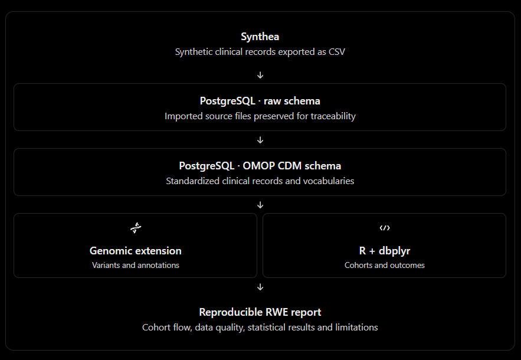

# RWE Pipeline for Clinical Genomics and Longitudinal Patient Outcomes


A reproducible workflow for integrating synthetic electronic health record (EHR) and genomic data to explore real-world evidence (RWE), clinical cohort construction, and longitudinal patient outcomes.

### 🚧=======================================🚧
### 🚧*!!!!!!!! Project in Progress !!!!!!!!!!*🚧
### 🚧 The workflow is currently functional through the `ETL_Synthea.R` step. Additional integration, analysis, and documentation are under development.
### 🚧=======================================🚧

---

## Table of Contents

- [Overview](#overview)
- [Objectives](#objectives)
- [Workflow](#workflow)
- [Technology Stack](#technology-stack)
- [Repository Structure](#repository-structure)
- [Data Sources](#data-sources)
- [Pipeline Steps](#pipeline-steps)
- [Getting Started](#getting-started)
- [Planned Extensions](#planned-extensions)
- [Disclaimer](#disclaimer)

---

## Overview

Real-world evidence research uses data from clinical practice to investigate disease progression, treatment patterns, and patient outcomes. This project provides a hands-on framework for developing an RWE pipeline using synthetic clinical data, with an emphasis on clinical genomics and longitudinal analysis.

The workflow is designed to demonstrate data ingestion, database integration, cohort construction, and analysis while providing a foundation that can be adapted for appropriately governed real-world clinical data.

## Objectives

- Generate and process synthetic EHR data using **Synthea**.
- Load and organize clinical data in **PostgreSQL**.
- Use **R** and **dbplyr** for database-connected data manipulation.
- Design a framework for integrating genomic variant data with longitudinal clinical records.
- Develop reproducible clinical cohort definitions and patient-outcome analyses.
- Establish a modular workflow that can be extended to real-world clinical datasets.

## Workflow

<!-- Replace the path below with the location of your workflow PNG in the repository. -->



*Figure 1. Planned workflow for synthetic clinical and genomic data integration and RWE analysis.*

## Technology Stack

| Technology | Purpose |
|---|---|
| R | Data processing, statistical analysis, and reporting |
| PostgreSQL | Relational database storage and querying |
| dbplyr | Database-backed data manipulation from R |
| Synthea | Synthetic patient and EHR data generation |
| ETL-SyntheaBuilder | Loading Synthea data into database tables |
| Git and GitHub | Version control and project documentation |


## Repository Structure

```text
RWE-Pipeline/
├── README.md
├── ETL_Synthea.R
├── scripts/
│   ├── generate_synthetic_variants.R
│   ├── integrate_genomics.R
│   └── rwe_analysis.R
├── images/
│   └── rwe_pipeline.png
├── sql/
│   └── schema.sql
├── data/
│   └── README.md
└── reports/
    └── README.md
```

*Note: This structure illustrates the intended organization. Scripts and directories may be added as development progresses. Generated data and local credentials should not be committed to the repository.*


## Data Sources

### Synthetic clinical data

Synthea generates synthetic patient records and associated healthcare information for development and testing. These records provide the clinical foundation for the pipeline.

### Synthetic genomic data

A separate synthetic genomic dataset is planned to represent variant calls and gene annotations. Genomic records will be linked to synthetic patients through explicit identifiers and documented assumptions.

**Important:** Genomic records added to this project are simulated extensions; they are not standard Synthea outputs.


## Pipeline Steps

| Step | Description | Status |
|---|---|---|
| 1. Synthetic EHR generation | Generate synthetic patient and clinical records with Synthea | Complete / verify |
| 2. Clinical ETL | Load Synthea data into PostgreSQL | In progress |
| 3. Synthetic variant generation | Create example genomic variant records and annotations | Planned |
| 4. Clinical-genomic integration | Connect genomic records to synthetic patient identifiers | Planned |
| 5. Cohort construction | Define patient cohorts using clinical and genomic criteria | Planned |
| 6. Longitudinal outcomes | Explore outcomes over time using available synthetic records | Planned |
| 7. Reporting | Generate reproducible tables, summaries, and visualizations | Planned |

*Update the status column as individual steps are implemented and tested.*


## Getting Started

### Prerequisites

- R and RStudio
- PostgreSQL
- Java and a compatible Synthea installation
- Required R packages, including `DatabaseConnector`, `ETLSyntheaBuilder`, and `dbplyr`
- Synthetic Synthea output files

## **Pipeline & Configuration**
**===========================**

## [Synthea]: Patient Generator
===============================
#### [GitHub](https://github.com/synthetichealth/synthea)
#### [Wiki](https://github.com/synthetichealth/synthea/wiki)
- Generates synthetic and realistic patient (EHR) data
- includes patient histories, encounters, conditions, medications, laboratory results, observations
- exports CSV and FHIR formats

### Download Synthea prebuilt JAR
    - using a prebuilt JAR for simplicity
    - went with v3.3.0 to match the ETL packages in later steps
```bash
mkdir -p ~/synthea
cd ~/synthea

wget https://github.com/synthetichealth/synthea/releases/download/v3.3.0/synthea-with-dependencies.jar
```
#### RUN `synthea.sh` to generate synthetic patient records in csv files


## [PostgreSQL]: database schema
================================
#### [Windows Installer](https://www.postgresql.org/download/windows/)
- Set up PostgreSQL if needed
- Configure the PostgreSQL connection and target schemas locally
- Use 'pgAdmin' to create a Database called 'syntheadb'

| PostgreSQL Schema | Contents |
|-------------------|----------|
| `native` | Raw Synthea CSV imports |
| `cdm` | OMOP-standardized clinical tables |
| `genomics` | Custom synthetic genomic tables and annotations |
| `analysis` | Derived cohorts, features, and outcome tables |


## [OHDSI](https://www.ohdsi.org/software-tools/)
==========
- OHDSI provides open-source tools for cohort construction, patient characterization, and observational analyses.
- Standardized Clinical Data Layer

### Build Standardized Vocabulary Tables with [ATHENA](https://athena.ohdsi.org/)
- Required for ETL-Synthea to load clinical data into the database


## [OHDSI ETL-Synthea]: a Utility to Load Synthea CSV data to OMOP CDM
=====================================================================
#### [GitHub](https://github.com/OHDSI/ETL-Synthea)
#### [Tutorial](https://ohdsi.github.io/Tutorial-ETL/)
- ETL (Extract, Transform, Load) pipeline that converts synthetic healthcare data from Synthea into the OMOP Common Data Model (CDM).
- Install the required software and R packages. See: `installation_guide.r`
- Run `ETL_Synthea.R` to begin the clinical data loading process.


🚧🚧🚧🚧🚧🚧🚧🚧
```bash
** PROJECT CONSTRUCTION **
==========================
## TODO:

# Define Cohort:
## [dbplyr]: Analytical Queries
**=============================================================**
#### [GitHub](https://github.com/tidyverse/dbplyr)
#### [Tutorial](https://dbplyr.tidyverse.org/articles/dbplyr.html)
- `dbplyr` translates R code into SQL queries to pull from a database
# A typical RWE study defines a population, an index date, baseline characteristics, exposure or genomic features, and an outcome window.
# Use a phenotype such as type 2 diabetes if it is represented adequately in the generated data. Obtain the relevant standardized concept IDs from the loaded vocabulary, rather than guessing code values.
# Also define a minimum prior-observation period, exclusions, and rules for repeated diagnoses. The earliest diagnosis recorded in Synthea is not necessarily the patient's true disease onset.
# RUN /src/define.r

## [Derive a longitudinal clinical outcome]:
============================================
- Connect the cohort to a clinical measurement.
# RUN /src/outcome.r


# [Analyze and report the results]:
===================================
- Once you have a patient-level dataset with an outcome and a prespecified genomic feature, you can run descriptive analyses and appropriate statistical models in R.


## [OHDSI CohortMethod]
=======================
#### [GitHub](https://github.com/OHDSI/CohortMethod)
- A later-stage resource for propensity scores and comparative outcome analyses in an OMOP research environment
- An open-source R package for conducting observational comparative effectiveness and safety studies
- Uses healthcare data standardized to the Observational Medical Outcomes Partnership (OMOP) Common Data Model


## Build Genomic extension: 
===========================
### synthetic variant records, variant annotations, and gene-level features linked to synthetic patient IDs.

```
🚧🚧🚧🚧🚧🚧🚧🚧

**Configuration notes:** Database credentials, local file paths, and other environment-specific settings should be supplied locally rather than hard-coded into scripts committed to GitHub.

## Planned Extensions

- [ ] Complete and validate the Synthea ETL process.
- [ ] Create a documented synthetic genomic variant dataset.
- [ ] Integrate clinical and genomic tables in PostgreSQL.
- [ ] Implement example clinical cohort definitions.
- [ ] Perform longitudinal patient-outcome analyses.
- [ ] Add reproducible reports and visualizations.
- [ ] Document data quality checks and workflow limitations.

## Disclaimer

This repository is an educational and developmental project using synthetic data. It is not intended for clinical decision-making or direct patient care.

Any future adaptation to real-world clinical data will require appropriate authorization, privacy safeguards, data governance, and validation before research use.

---

*Developed as a practical portfolio project in bioinformatics, clinical data engineering, and real-world evidence analytics.*
